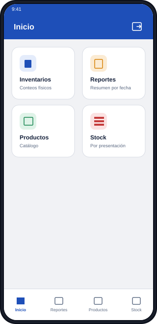
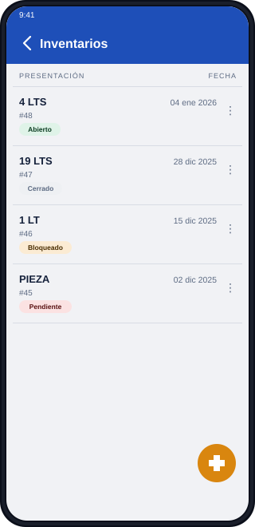
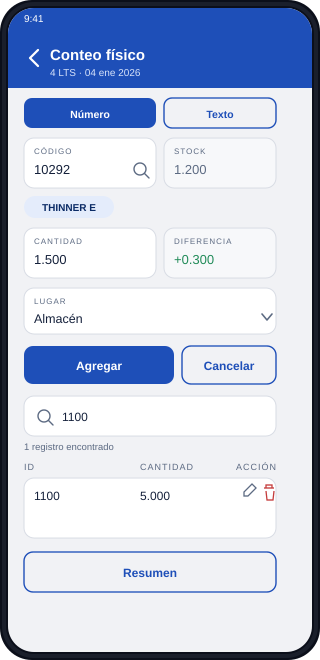
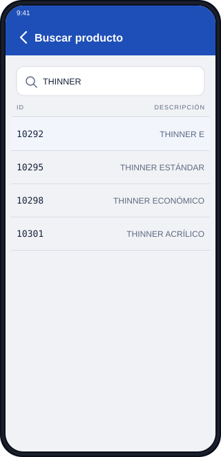
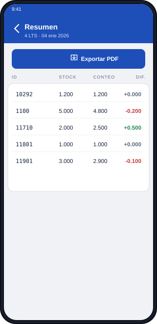
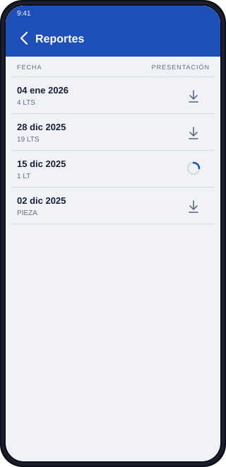
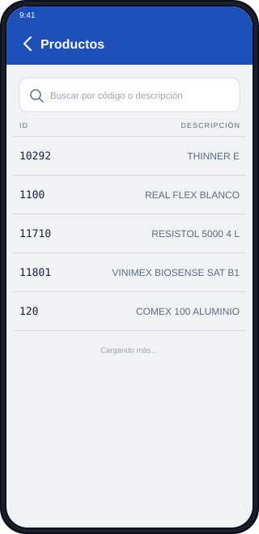
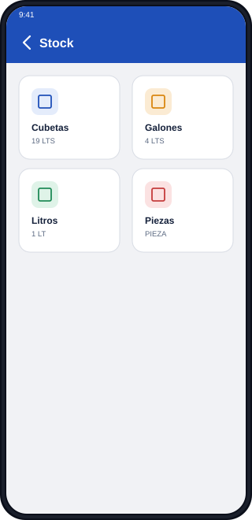
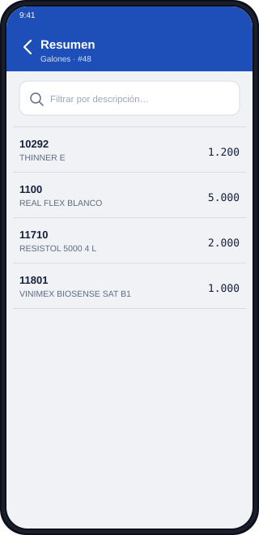

# Inventario Comex — App Android (local, sin servidor)

Aplicación Android nativa (Java) para levantar conteos físicos de inventario en piso de almacén: carga del reporte de existencias (CSV) del proveedor, captura de conteos contra el stock esperado, alta de productos no registrados, resumen con diferencias, reportes en PDF y consulta del catálogo/stock por presentación.

Es la fusión de dos proyectos hermanos en una sola app que **no necesita red ni servidor**:

- `inventory-comex-adroid`: la app cliente (pantallas, escáner de códigos de barras).
- `inventory-comex/Backend/Inventories`: el backend Spring Boot + MySQL, cuya lógica de negocio ahora corre dentro de la app sobre SQLite.

Está pensada para **una sola persona en un solo dispositivo**: los datos viven en el teléfono, así que no hay login, configuración de servidor ni bloqueo de inventarios entre dispositivos.

## Capturas (mockups)

> Mockups con datos ficticios (SVG, en [`docs/mockups`](docs/mockups)). Son de la app cliente original; las pantallas de esta versión son las mismas salvo login y "Mi cuenta", que ya no existen.

<table>
  <tr>
    <td align="center"><br/><sub><b>Inicio</b></sub></td>
    <td align="center"><br/><sub><b>Inventarios</b></sub></td>
    <td align="center"><br/><sub><b>Conteo físico</b></sub></td>
  </tr>
  <tr>
    <td align="center"><br/><sub><b>Buscar producto</b></sub></td>
    <td align="center"><br/><sub><b>Resumen del conteo</b></sub></td>
    <td align="center"><br/><sub><b>Reportes</b></sub></td>
  </tr>
  <tr>
    <td align="center"><br/><sub><b>Catálogo de productos</b></sub></td>
    <td align="center"><br/><sub><b>Stock por presentación</b></sub></td>
    <td align="center"><br/><sub><b>Existencias del inventario</b></sub></td>
  </tr>
</table>

## Funcionalidad

- **Inventarios**: listado con estado (Abierto/Pendiente/Cerrado), alta desde el CSV del proveedor, cierre, reapertura y borrado.
- **Carga del CSV**: misma limpieza que hacía el backend (4 filas de encabezado, columnas vacías, 2 filas de pie, columna opcional `COD BARRAS`, UTF-8 o Windows-1252). Crea el inventario, da de alta productos nuevos, registra el stock y las presentaciones con su código de barras, todo en una transacción.
- **Conteo normal y guiado**: captura por código, código de barras (cámara) o búsqueda por nombre; alta de productos no registrados; asignación de códigos de barras a presentaciones.
- **Resumen y reportes**: diferencias por producto (incluye productos contados que no venían en el stock) y PDF con el balance del conteo.
- **Catálogo y stock por presentación**: consulta paginada con búsqueda, edición de descripción y códigos de barras.

## Arquitectura

Las pantallas no cambiaron su forma de pedir datos: siguen llamando `api.metodo(...).enqueue(callback)`. Lo que cambió es qué hay detrás.

```
app/src/main/java/com/example/myapplication/
├── *Activity.java        # Una Activity por pantalla (sin cambios de fondo respecto a la app cliente)
├── InventoryApp.java      # Application: inicializa la base de datos
├── api/                   # *Api = puerto de cada controller del backend; Call/Callback/Response; DTOs
├── db/AppDatabase.java    # SQLiteOpenHelper con el esquema equivalente a las migraciones V1–V5
├── domain/                # Parser del CSV del proveedor y enum de presentaciones (Java puro, con pruebas)
├── report/                # PDF del conteo con android.graphics.pdf.PdfDocument
├── scanner/               # Cámara + ML Kit para códigos de barras
├── adapter/, util/
```

| Backend (Spring Boot) | App local |
|---|---|
| Controllers REST + JPA | `api/*Api` con SQL sobre `SQLiteDatabase` |
| MySQL + Flyway | SQLite (`AppDatabase`, versión de esquema en `onUpgrade`) |
| commons-csv | `domain/CsvReader` (RFC 4180) |
| iText 5 (AGPL) | `PdfDocument` del framework |
| JWT, usuarios, CORS, bloqueo de inventarios | No aplican (un solo usuario y dispositivo) |
| Retrofit/OkHttp/Gson en la app | Eliminados; `Call` ejecuta en un hilo de fondo y responde en el principal |

`Call` usa un único hilo para todas las operaciones: se ejecutan en el orden en que se piden y nunca hay dos escrituras simultáneas. `Response` conserva los códigos del backend (200, 400 y 404) porque las pantallas ya distinguen esos casos.

## Datos y respaldo

- La base de datos es `inventories.db` dentro del almacenamiento privado de la app. **Desinstalar la app o borrar sus datos elimina todos los inventarios** que no se hayan exportado.
- **Inicio → Respaldo de datos** exporta todo (catálogo, códigos de barras, inventarios con stock y conteos) a un archivo JSON e importa ese archivo de vuelta. Importar combina sin borrar: crea los productos que faltan, actualiza descripciones y códigos de barras, y agrega los inventarios como nuevos. Si vuelves a importar el mismo archivo, los inventarios se duplican.
- El archivo usa el formato `comex-inventory-backup`, el mismo que exporta la app cliente desde el servidor (`GET /data/export`). Así se carga en ComexBeta el catálogo del backend y se pueden pasar los datos de vuelta (`POST /data/import`).
- `allowBackup` está activo, así que el respaldo automático de Android (cuenta de Google) también incluye la base de datos.
- El `applicationId` es `com.comex.inventario.local`, distinto al de la app cliente, para que ambas puedan instalarse en el mismo teléfono.

## Requisitos

- Android Studio con JDK 17 y Android SDK con `compileSdk`/`targetSdk` 37.
- Dispositivo o emulador con Android 7.0 (API 24) o superior.

## Cómo correrlo

```bash
./gradlew assembleDebug                 # app/build/outputs/apk/debug/app-debug.apk
./gradlew installDebug                  # instala en un dispositivo/emulador conectado
./gradlew testDebugUnitTest             # parser CSV, paginación y balance (JVM)
./gradlew connectedDebugAndroidTest     # capa api/ + SQLite completa (requiere dispositivo)
```

Para empezar, carga un CSV de existencias desde **Inventarios → +**.

## Licencia

Proyecto interno sin licencia pública definida.
